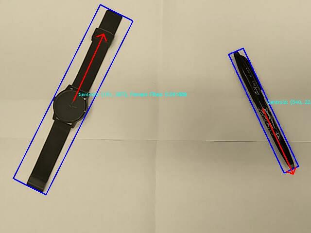

Recognise objects on a tabletop from a live webcam, using classical computer vision and nothing else — no learned features, no pretrained backbone. Camera overhead, dark objects on a white surface, everything computed per frame in C++.

The constraint that made this interesting: most of the pipeline had to be written from scratch. Two of the first four stages were required to be; three ended up that way. The only OpenCV algorithm doing real work is connected-component labelling.

*Two objects at once. Blue boxes are the oriented bounding boxes, red arrows the axis of least central moment, cyan text the live feature values.*

---

## Pipeline

### Thresholding, without Otsu

Rather than call a threshold function, the threshold is found by **2-means clustering on sampled pixel values**. Sample the frame, converge two centroids — one settles on the dark object population, one on the light background — and put the threshold at their midpoint.

The appeal is that it's *adaptive by construction*. As the lighting shifts, both centroids move and the threshold tracks them, without a hand-tuned constant anywhere. It's a genuinely better fit for a live feed than a fixed cut, and it's about fifteen lines of code.

### Morphological cleanup

The thresholded feed had holes in it — printed text and specular highlights on dark objects read as background. So: **dilation first to close the gaps, then erosion to remove the speckle** the dilation amplified. Written by hand rather than called, and the ordering was driven by looking at the actual defect rather than reaching for a default.

### Segmentation

`cv::connectedComponentsWithStats` labels the regions; components below a size threshold are dropped as noise. Survivors get distinct colours for display.

### Features, from moments up

Raw and central moments computed directly, then five descriptors per region:

| Feature | What it captures |
|---|---|
| Centroid (x, y) | Region position |
| θ | Angle of the axis of least central moment — the object's orientation |
| Percent filled | Region area ÷ oriented bounding box area |
| Bounding box ratio | Oriented box aspect ratio |

Stored to CSV alongside a label typed at capture time, which makes the training set inspectable — you can open it and see why the classifier does what it does.

## Classification

Two classifiers over the same features:

- **Nearest neighbour** on cumulative scaled Euclidean distance — closest labelled example wins.
- **k-NN with k = 4** — take the four nearest, majority vote.

The k-NN version is the more robust of the two, and the reason is visible in the failure mode of the first. Nearest neighbour commits to a single best match, so when two classes differ only marginally in feature space, one noisy frame is enough to flip the decision. Requiring agreement among four neighbours means a single outlier can't carry the vote.

---

## Results

**11 object classes**, roughly 30 labelled samples captured at varying positions and orientations: watch, pen, mobile, spoon, bracelet, earbuds box, pendrive, statue, controller, star, clutch. Over 15 trials across five classes, classification accuracy ran **93.33–100%**.

The more informative result is how well the shape features separate the classes:

| Feature | Range across the 11 classes |
|---|---|
| Percent filled | 0.34 (bracelet — a hollow loop) → 0.97 (phone — a filled rectangle) |
| Bounding box ratio | 1.04 (near-square box) → 8.88 (pen) |

Those two numbers do most of the discriminating, and they're both scale- and rotation-invariant, which is the whole reason for computing orientation first and measuring the box *after* aligning to it. Deliberately including several elongated objects — pen at 8.88, watch strap at 5.31, spoon at 3.99 — was what stress-tested it; anything can separate a pen from a phone, but separating a pen from a watch strap needs the percent-filled term to pull its weight.

An extension pushed it to **multiple objects simultaneously**, segmenting and classifying every region in the frame rather than assuming one object at a time.

## Honest limitations

**The feature vector includes absolute centroid position.** Centroid x and y range from 165 to 484 px across the dataset, and feeding those into a scaled-Euclidean distance means *where the object sits in frame* contributes to the class decision — in a system whose stated goal is translation invariance. The three shape descriptors are the invariant ones and are doing the real work; the centroid terms are a liability I'd drop.

**Lighting drives everything.** The 2-means threshold adapts, but it can only adapt to a bimodal scene. Introduce a shadow gradient across the white surface, or a mid-grey object, and the two-cluster assumption stops holding.

**No timing was measured.** The system runs interactively on a live feed, but there's no frame-rate figure behind that, so I won't claim one.

## Stack

C++, OpenCV 4, CMake. Thresholding, morphology and the entire moment/feature pipeline hand-written; `connectedComponentsWithStats` for labelling. Training data self-collected via an in-app capture-and-label mode, with recording built in for demos.
