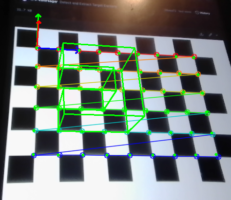
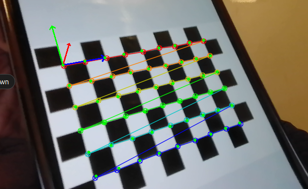
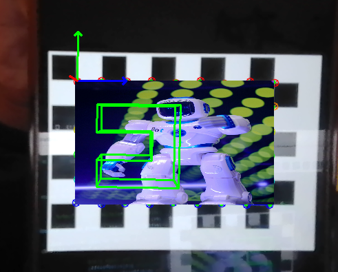
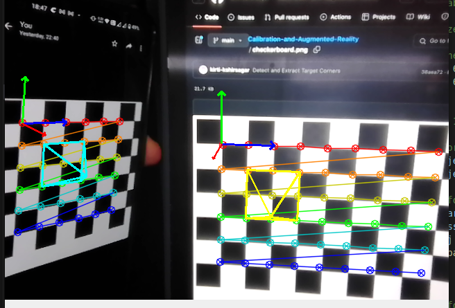

Everything in marker-based AR rests on one number: how well you know the camera. This project works through that chain end to end in C++/OpenCV — detect a calibration target, solve for intrinsics, recover live pose, and project virtual geometry that stays locked to the target as the camera moves.


*The virtual object holding its pose against the board.*

---

## Calibration

A **9×6 chessboard giving 54 interior corners**, detected on a live stream with sub-pixel refinement. Pressing `s` banks the current frame's corner locations along with their corresponding 3-D world points; `cv::calibrateCamera` then solves for intrinsics and distortion. Fewer than five frames and it refuses — the parameters aren't determined.

Recovered intrinsics for the laptop camera, from an initial guess of nothing more than a principal point at the image centre:

$$K = \begin{bmatrix} 611.41 & 0 & 311.84 \\ 0 & 613.70 & 236.82 \\ 0 & 0 & 1 \end{bmatrix}$$

**Final reprojection error: 0.545 px.** Intrinsics and distortion coefficients are written out as OpenCV YAML so later runs skip calibration entirely.

### Two cameras, one surprise

Running the same procedure on an external USB webcam gave a notably better fit:

| Camera | fx, fy | cx, cy | Reprojection error |
|---|---|---|---|
| Laptop integrated | 611.41, 613.70 | 311.84, 236.82 | 0.545 px |
| External USB webcam | 690.48, 693.37 | 344.83, 239.23 | **0.150 px** |

The webcam calibrates about **3.6× better** — and the interesting part is that it does so while having *substantially larger* distortion coefficients (k1 = −0.446 against −0.215, k3 = −4.44 against −1.76). More distortion, better fit. Those aren't contradictory: the reprojection error measures how well the *model* explains the observations, not how mild the lens is. A strongly distorted lens whose distortion is well-described by the radial polynomial will beat a milder lens whose residual behaviour the model can't represent. Cheap wide optics can calibrate beautifully; the question is whether the model matches the physics.

## Pose

With intrinsics fixed, `solvePnP` returns rotation and translation per frame. The sanity check is nicer than eyeballing an overlay — translate the camera to the right and watch the numbers:

```text
tvec  [7.378, 6.753, 40.531]
tvec  [7.627, 6.719, 40.485]
tvec  [7.759, 6.711, 40.504]
tvec  [8.070, 6.713, 40.486]
```

X climbs monotonically, 7.378 → 8.070, while Y holds near 6.71 and Z near 40.49. That's exactly right for pure lateral motion, and it's a check on the physical meaning of the solution rather than on whether the render happens to look plausible.


*Detected corners and the projected 3-D axes at the board origin.*

`cv::projectPoints` then puts 3-D world points back onto the image plane — the board corners, RGB axes at the origin, and a virtual object defined as **15 points forming an inverted C**, connected by lines drawn between their projections.

---

## Extensions

**Making the marker stop looking like a marker.** The strongest result here: find the board's four extreme corners, warp an arbitrary image into that quadrilateral, and render the virtual object on top of the warped result. The chessboard is still doing all the pose work underneath, but it's no longer visible — which is the difference between a calibration demo and something you'd actually want in a scene.


*The board's squares fully replaced, virtual geometry still tracking correctly.*

**Two boards at once.** A (9,6) and a (6,6) board handled in a single frame, each solved for pose independently and each rendered with its own coloured pyramid. It degrades gracefully — remove one board and the other keeps tracking.


*Independent pose solutions for two different board geometries in one frame.*

**Pre-recorded video mode.** Pressing `p` runs the whole pipeline over recorded footage instead of the live feed, inserting virtual objects into video after the fact.

## Toward markerless

`cv::cornerHarris` was added to explore features that don't require a known target, swept over threshold, block size, aperture size and the Harris free parameter *k*. Raising the threshold from 150 to 200 visibly thins the detections, dropping the finer corners first.

Detection is where this stopped, and it's worth being precise about that: **the markerless pipeline was designed, not built.** Going from Harris corners to a pose estimate needs frame-to-frame correspondence — SIFT or SURF descriptors matched across frames, then a transformation recovered from the matches, then projection using that pose. That's the natural continuation and it isn't implemented here.

## A note on the target

The chessboard in these figures is being **displayed on a phone screen** rather than printed. Convenient, and it never creases — but it's a glossy emissive surface, which introduces specular highlights and probably accounts for some of the laptop camera's worse reprojection error. A matte printed target on rigid backing is the better choice if the calibration itself is what matters.

## Stack

C++, OpenCV 4, CMake, on Windows and Ubuntu. `calibrateCamera`, `solvePnP`, `projectPoints`, `cornerHarris`; intrinsics persisted as OpenCV YAML. Two cameras: a laptop integrated camera and an external USB webcam.
