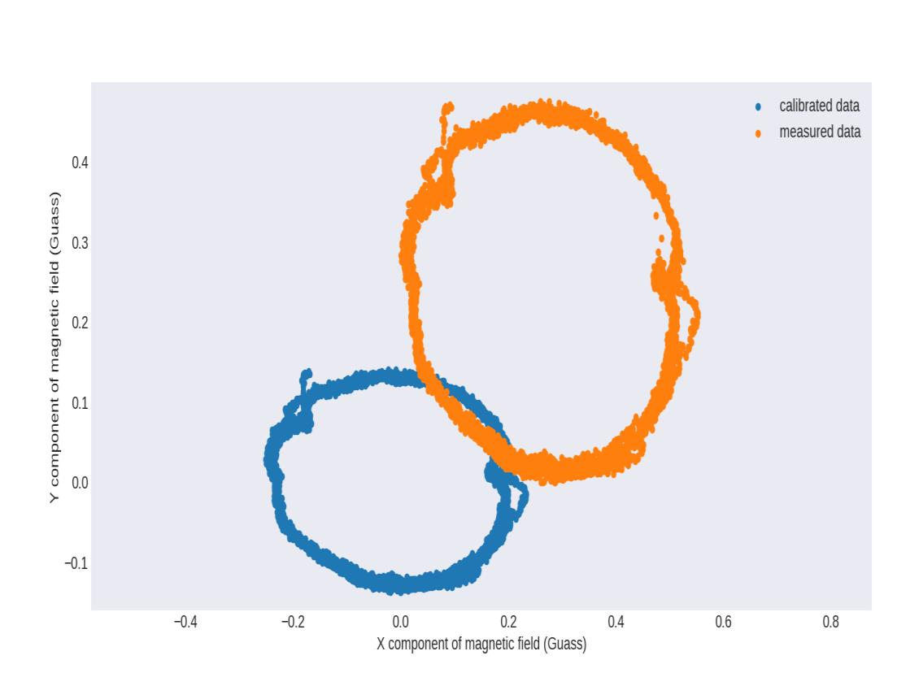
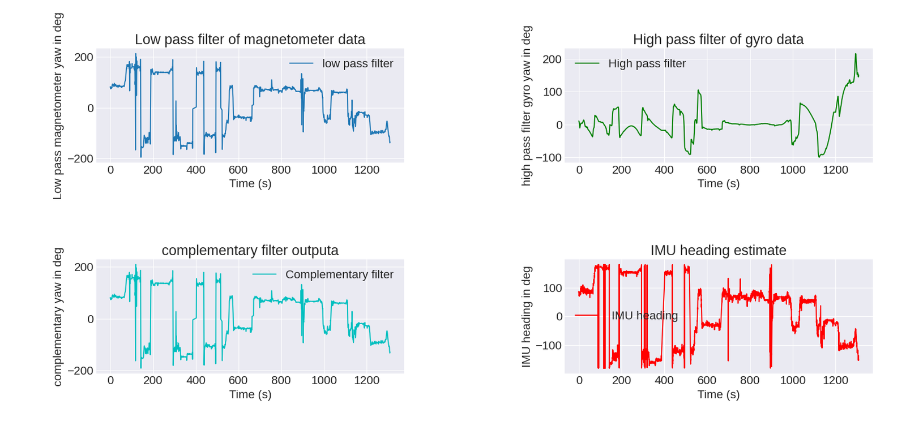
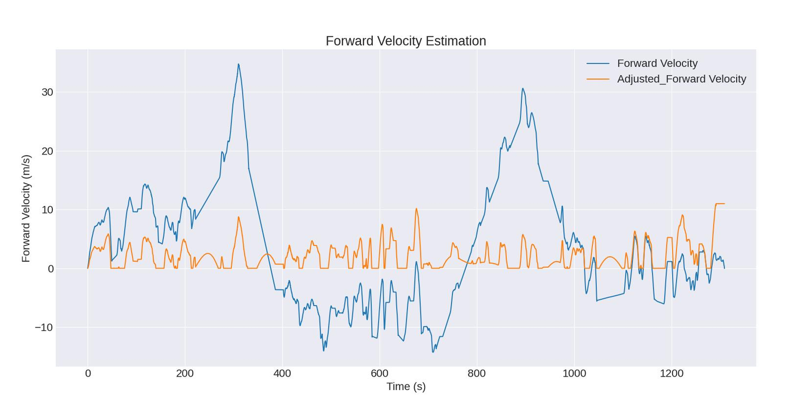
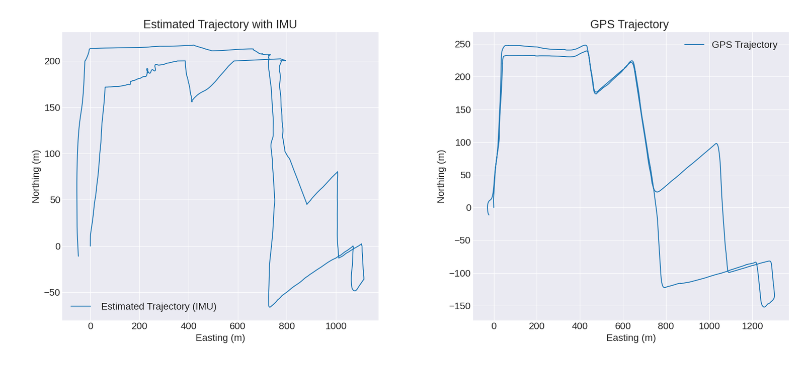

Take away the GPS fix and a vehicle has to work out where it is from acceleration and rotation alone. This project does that end to end on real data — instrument a car, calibrate the magnetometer properly, fuse a heading estimate, integrate forward velocity, and reconstruct the trajectory — then compares the result against GPS to find out how long dead reckoning actually survives.

The short answer: **about three minutes.** After that it is off by the length of a city block.

Coursework for **EECE5554: Robotics Sensing and Navigation** at Northeastern.

---

## Setup

A **VectorNav VN-100** IMU mounted inside the vehicle in a custom holder, deliberately aligned so its **x-axis points along the vehicle's forward direction** and the unit sits level. That alignment is doing real work later — it's what lets `accel_x` be treated as forward acceleration and `accel_y` as lateral without a rotation. A magnetic-mount GPS puck went on the roof, both feeding one laptop over ROS.

Two datasets:

- **Circles** — five laps of the Ruggles station circle, recorded purely to excite the magnetometer through a full 360° of heading. This is calibration data, not navigation data.
- **Driving** — a 2–3 km route around Boston with at least ten turns, roughly 1300 s, routed to avoid tunnels and underpasses so the GPS reference stays continuous.

---

## Magnetometer calibration

An uncalibrated magnetometer driven in a circle should trace a circle. It doesn't, and the two ways it fails are visually distinguishable from the same scatter plot:

*Five laps of the Ruggles circle. Orange is raw, blue is corrected.*

- **The ring is off-centre** → **hard iron** distortion. A constant field offset from permanent magnets, ferrous structure or current-carrying conductors near the sensor. The raw ring here sits up and to the right of the origin, biased by roughly 0.27 G in x and 0.22 G in y. Correction is a per-axis bias subtraction that recentres the cluster.
- **The ring is deformed** → **soft iron** distortion. Non-uniform scaling and rotation from nearby ferrous material. You can see it in both rings as a distinct kink near the +x side — the shape isn't circular and no amount of translation fixes that. Correction is a matrix that scales and rotates the data back toward a circle.

The parameters come from a least-squares ellipse fit to the circle-driving data, applied as bias subtraction followed by the correction matrix. Being able to read *which* distortion you have off the plot before fixing either is the useful part of this exercise — the two have different causes and different remedies, and the geometry tells you which you're looking at.

## Heading

Neither heading source is usable alone. The magnetometer gives absolute heading but is noisy and sensitive to the vehicle's own electrical and magnetic environment. The gyro is clean over short intervals but integrates its bias without bound — the raw integrated yaw here climbs to about **+405°** by t ≈ 560 s and plateaus near 300°, which is meaningless as an absolute heading.

A complementary filter takes the half of each signal that's trustworthy:

- **0.5 Hz low-pass** on magnetometer yaw — keeps the slow-moving absolute reference, discards the noise
- **0.1 Hz high-pass** on gyro yaw — keeps short-term rate fidelity, discards the drift
- blended with coefficient **0.98**

*The two filtered branches, the fused output, and the VN-100's internal estimate for comparison.*

---

## Forward velocity, and the number that gave the game away

Integrating raw accelerometer output produces nonsense. The raw forward-velocity trace peaks around **+35 m/s** and dips to **−15 m/s** — the car did neither. That's accelerometer bias being integrated into an unbounded ramp, plus road vibration and the gravity component that any unnoticed slope injects into the forward axis.

Two corrections bring it into physical range: a high-pass filter on forward acceleration to strip the low-frequency bias, then clamps — negative velocities to zero, plus an upper bound. That gets the adjusted trace to a plausible **0–11 m/s**, against GPS-derived velocity peaking at 12.7 m/s.

*Blue: integrate the raw signal and the car reaches 35 m/s and reverses. Orange: after high-pass filtering and clamping.*

Then aligning the dead-reckoned track to GPS required scaling the IMU distances by **2.25×**.

That factor is the most informative number in the whole project, and it isn't a calibration constant — it's a symptom. A 2.25× scale error means the integrated velocity was systematically **less than half** the true speed, and both corrections above are implicated. The high-pass filter that removed accelerometer bias also removed genuine low-frequency acceleration, because a car accelerating gently from a light and a slowly-drifting bias occupy the same part of the spectrum. And clamping negative velocity to zero doesn't just discard drift — it **rectifies** the signal, converting every real deceleration the drifting integrator pushed below zero into "stationary". Distance travelled comes out short in both cases.

**The filter that fixed the drift destroyed the scale.** Getting both would need the bias estimated as a state rather than filtered out — which is the argument for a Kalman filter over hand-tuned Butterworths, and the direction I'd take this next.

## Trajectory

*Dead-reckoned track (left) against GPS (right). The shape survives; the extent doesn't.*

Projecting forward velocity onto the fused heading and integrating gives the track above, aligned to GPS by matching start coordinates and the first straight segment.

- The two agree to within about **2 m for the first 150–200 s**
- After that they diverge, reaching roughly **400 m** of displacement error by the end of the ~2–3 km route

Dead reckoning worked best exactly where you'd expect — early, on straight, level road. It degraded with each successive turn, and the two causes are **gyro bias instability** feeding heading error into every subsequent position update, and **unanticipated road slopes** tilting gravity onto the forward axis where it gets integrated as acceleration.

One honest wrinkle in the alignment: the IMU track was rotated 14° and the GPS track 25°, in opposite service of making the first straight segments agree. Rotating *both* by *different* amounts means the result no longer references true north — a single rotation of the difference would have been the defensible choice.

## The takeaway

There's a usable operating envelope here and it's narrow. Roughly **150–200 seconds of GPS outage** is survivable at 2 m accuracy, which is enough to cross a tunnel or an urban canyon. It is nowhere near enough to navigate on, and the failure is not graceful — error grows superlinearly as heading error compounds. Any real system needs periodic absolute fixes, and the interesting engineering question is how sparse those fixes can be, not whether you need them.

## Stack

ROS (rosbag, sensor nodes), Python, SciPy (`butter`/`filtfilt`, least-squares fitting), matplotlib, UTM projection. Hardware: VectorNav VN-100, magnetic-mount GPS puck, Northeastern's instrumented "nuance" vehicle.
