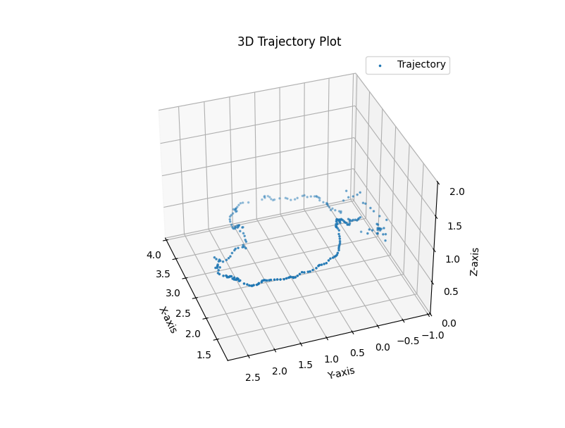

An evaluation and deployment project rather than an algorithms one. [Kimera-VIO](https://github.com/MIT-SPARK/Kimera-VIO) from MIT-SPARK was used as shipped; the work here was getting it running reproducibly, reproducing its published benchmark on EuRoC, and then pointing it at a sequence it had never seen — recorded on an Intel RealSense D455 in an ordinary office — to find out what breaks when you leave the benchmark behind.

---

## What Kimera-VIO is doing

Worth stating, because the interesting failure later only makes sense against it.

**Front end.** Shi-Tomasi corners on the left stereo image, tracked temporally with Lucas–Kanade optical flow, matched left-to-right and triangulated for depth, with outlier rejection on the resulting correspondences. IMU measurements between keyframes are preintegrated into a single relative-motion constraint and used for gravity alignment.

**Back end.** A factor graph over position, orientation and velocity, with IMU factors and visual reprojection factors as edges, optimised incrementally by **iSAM2** in GTSAM. Robust losses (Huber, Cauchy) absorb the outliers that survive the front end. Output is a pose trajectory, velocity estimates and a sparse landmark map.

**Loop closure.** Kimera-RPGO detects loops and runs robust pose-graph optimisation over them to produce a globally consistent trajectory.

## Reproducibility

The deliverable that mattered most was a **saved Docker image** with Kimera-VIO, ROS and every dependency preinstalled — distributed as a tarball so the whole pipeline comes up in three commands:

```bash
docker load -i kimera-vio.tar
docker run -it kimera-vio
python3 visual.py data_pgo.csv     # inside the container
```

Anyone who has built a VIO stack from source knows why this is worth doing. Kimera-VIO wants a specific GTSAM, which wants a specific Boost and Eigen, and the failure mode of getting it wrong is a pipeline that compiles and then silently estimates garbage. Pinning the whole environment means a result someone else can actually reproduce, and it makes "does this parameter change help?" a question you can answer in an afternoon instead of a week.

Stereo image pairs and IMU streams were synchronised and fed in through ROS.

---

## EuRoC benchmark

Run on the **EuRoC MAV** Vicon Room 1 sequences — `V1_01`, `V1_02` and `V1_03`, spanning easy, medium and difficult, with motion-capture ground truth. That's three of the dataset's eleven sequences; the Machine Hall and Vicon Room 2 sets weren't covered.

ATE RMSE in metres, reproducing the published comparison across VIO pipelines:

| Sequence | OKVIS | MSCKF | ROVIO | VINS-Mono | Kimera-VIO |
|---|---|---|---|---|---|
| V1_01 | 0.09 | 0.34 | 0.10 | 0.08 | **0.05** |
| V1_02 | 0.20 | 0.20 | 0.10 | 0.11 | **0.08** |
| V1_03 | 0.24 | 0.67 | 0.14 | 0.18 | **0.07** |

The pattern worth noting is the third row. Every other pipeline degrades on `V1_03` — the difficult sequence, with faster and more aggressive motion — while Kimera-VIO holds at 0.07 m. Aggressive motion is *good* for a visual-inertial system: it excites the IMU, which is what makes scale and gravity direction observable in the first place. Getting parameters into the range where that benchmark reproduces meant tuning IMU noise models, feature thresholds and optimiser tolerances. Throughput came out around **25 FPS**.

## Custom dataset

Recorded with a **RealSense D455** in a room of desks, monitors and the usual office clutter, walking an approximately oval path back to the starting point.


*Trajectory after pose-graph optimisation. The plot renders the path in the x–y plane, so vertical motion isn't shown.*

There is **no ground truth** for this sequence — no motion capture in an office — so everything here is qualitative. No ATE, no drift percentage, and any number attached to it would be invented. What it does show is loop closure working: the path returns to where it started rather than spiralling away.

### Starting at rest

The most useful thing this sequence taught me was a failure at the very beginning of the recording, and it isn't a bug — it's a property of the problem.

Visual-inertial odometry recovers metric scale and gravity direction from the accelerometer. But an accelerometer at rest measures only gravity, and there is no way to separate "which way is down" from "how fast am I accelerating" without motion to disambiguate them. Start recording with the camera stationary and the initialiser has no excitation to work with; it converges on a poor estimate, and that error is baked into every pose that follows.

That's exactly what happened — visible drift accumulated from the start of the trajectory, and it persisted until loop closure corrected it. It also explains the EuRoC pattern above: the "difficult" sequence is easier for VIO in this one specific respect. The practical lesson is that a data-collection protocol matters as much as a config file: move the camera through a few seconds of varied motion **before** anything you care about, and the whole run improves.

Elsewhere in the sequence, low-texture regions produced feature sparsity and minor drift, which pose-graph optimisation largely absorbed.

## Limits and next steps

Kimera-VIO's weak points on this data were the ones its authors document: drift in low-texture regions, and sensitivity to outlier visual measurements. The obvious extensions, in order of how much they'd change the picture:

- **Metric-semantic mapping.** This used the VIO half of the Kimera suite only. Kimera-Semantics builds a semantically annotated mesh from the same pipeline, which is where the interesting downstream work is.
- **Outdoor and larger scale**, to see where the factor graph stops being tractable.
- **LiDAR as an additional modality**, for the feature-poor cases where vision alone degrades.

## Stack

Kimera-VIO (MIT-SPARK), GTSAM, ROS, Docker, Python, matplotlib. Datasets: EuRoC MAV V1_01–V1_03; self-collected RealSense D455 stereo + IMU.
