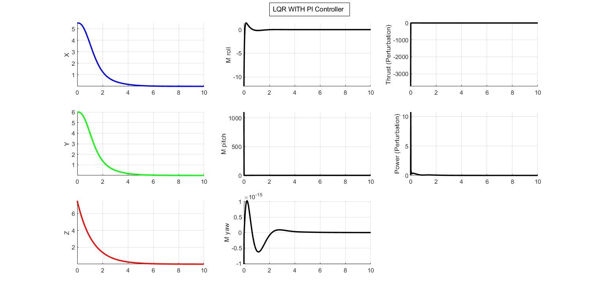
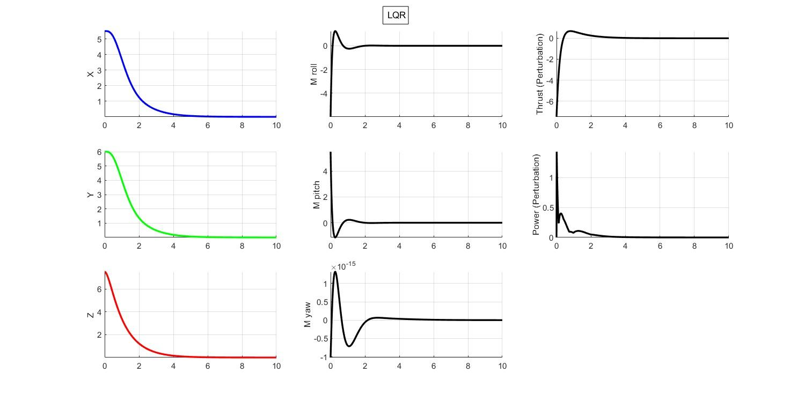

Three optimal-control formulations on the same quadrotor plant, compared on the same test, in MATLAB and Simulink. The interesting part turned out not to be which controller settles fastest — it was reading the control-effort axes afterwards and realising what the fastest one was spending to get there.

Coursework for **ME5659: Control Systems Engineering** at Northeastern.

---

## Plant

A 6-DOF rigid body from the Newton–Euler equations, following [Sabatino (2015)](https://www.diva-portal.org/smash/get/diva2:860649/FULLTEXT01.pdf):

$$m(\omega_B \wedge v_B + \dot{v}_B) = f_B, \qquad I\dot{\omega}_B + \omega_B \wedge (I\omega_B) = m_B$$

Four rotors give four control inputs — one collective thrust and three body torques:

$$u = [f_t \quad \tau_x \quad \tau_y \quad \tau_z]^\mathsf{T}, \qquad \tau_x = bl(\Omega_3^2 - \Omega_1^2)$$

Simulation constants: **m = 0.2 kg**, **Ix = Iy = 0.1**, **Iz = 0.15 kg·m²**, sample time **0.01 s**. Inertia is treated as diagonal, which assumes the body frame's origin and axes coincide with the barycentre and principal axes.

### Linearisation

Three stacked simplifications get from the nonlinear model to something `lqr()` will accept:

1. **Euler rates identified with body rates** — $[\dot\phi \; \dot\theta \; \dot\psi]^\mathsf{T} = [p \; q \; r]^\mathsf{T}$, valid for small angles.
2. **Small oscillations** — sines replaced by their arguments, cosines by unity.
3. **Hover equilibrium** — $\bar{u} = [mg \; 0 \; 0 \; 0]^\mathsf{T}$, the thrust that exactly cancels weight.

What comes out is fully decoupled: three double-integrator chains on attitude, three on position, with gravity coupling pitch into $\dot{u}$ and roll into $\dot{v}$. Twelve states, four inputs, and with $C = I_{12}$ (all states assumed measurable) both the controllability and observability matrices come back full rank 12.

The honest caveat on all of this: validity is bounded by the small-angle assumption and never quantified. A wind-disturbance matrix $D \in \mathbb{R}^{12 \times 6}$ is derived from the rotor and body-force channels — and then never exercised, since every simulation runs with `D = zeros`.

---

## Controllers

**LQR** — state feedback minimising $\int (x^\mathsf{T}Qx + u^\mathsf{T}Ru)\,dt$. Weights were left at $Q = I_{12}$, $R = I_4$; no weight tuning was performed, so all three controllers share the same underlying gain.

**LQR-PI** — PI action in the forward path, LQR state feedback around it, with an explicit injection point for unmodelled dynamics between the PI output and the plant. Integral action is what kills the steady-state error LQR leaves behind. Final hand-tune: `Kp = [500, 2, 200, 1]`, `Ki = [1, 1, 1, 1]`.

**LQG** — LQR plus a Kalman estimator, for the case where states are inferred rather than measured. Process noise covariance $10^{-3}$ on the six rate/velocity states, measurement noise $10^{-4}$.

## Test

Not a step response — a **regulation-to-origin decay**. The quadrotor starts displaced at (x, y, z) = **(5.5, 6, 7.5) m** with zero attitude and zero rates, reference at the origin, and each controller drives it home.

The study's summary comparison:

| Controller | Max overshoot | Settling time | Parameter sensitivity |
|---|---|---|---|
| LQR | 12% | 2.5 s | High |
| LQR-PI | 5% | 1.8 s | Moderate |
| LQG | 3% | 1.2 s | Low |

### Re-deriving it

Rebuilding the plant from the constants above and re-solving the LQR reproduces the original run exactly where it can be checked. Both the controllability and observability matrices come back rank 12; the open-loop eigenvalues are all zero — marginally stable, six pure integrator pairs, which is what you expect from a decoupled double-integrator model and worth noting because it means the plant is *not* asymptotically stable before feedback. Closing the loop puts every eigenvalue at Re ≤ −1.0. And the initial control effort comes out at

$$u(0) = [-7.5,\; -6.0,\; 5.5,\; 0]$$

matching the report's printed console output digit for digit — good evidence the model, weights and initial condition are transcribed correctly.

What doesn't reproduce is the table. With $Q = I_{12}$, $R = I_4$ and that initial condition, the position channels decay **monotonically with no overshoot at all**, settling to 2% in about **4.4 s** — not 12% overshoot in 2.5 s. The response plots in the report agree with the re-derivation rather than with its own summary table: all three position traces are smooth monotone decays reaching zero around 4–5 s.

So I'd treat the overshoot and settling-time figures as unreliable, and the ordinal sensitivity ranking as qualitative judgement rather than measurement. What follows below is the part that *is* visible in the data.

*LQR-PI. Positions decay cleanly — but look at the vertical axes in the right two columns.*

*LQR, same test, same panel layout. Same position traces, wildly different actuator numbers.*

---

## What the settling time cost

Put those two figures side by side and the position columns are nearly indistinguishable — both controllers bring x, y and z to zero inside about five seconds with no visible overshoot. The difference is entirely in the actuator channels:

| | LQR | LQR-PI |
|---|---|---|
| Thrust perturbation, peak | ≈ −6 | ≈ −3500 |
| Pitch moment, peak | ≈ +4 | ≈ +1000 |
| Power perturbation, peak | ≈ 1.5 | ≈ 10 |

LQR-PI pays roughly **500×** the peak thrust perturbation for a position response that is visually indistinguishable. That is a direct consequence of `Kp = [500, 2, 200, 1]` — the aggressive entries sit on exactly the thrust and pitch-torque channels where the blow-up appears. And unlike the settling times, this one is unambiguous: it's printed on the axes of the report's own figures.

On a real airframe those commands are far outside what any rotor can deliver, so the controller would saturate immediately and whatever settling-time advantage it has on paper would evaporate.

This is the part of the exercise that actually taught me something: a settling-time comparison with unbounded actuators isn't a comparison of controllers, it's a comparison of how hard each one is willing to push. Judge on overshoot and settling time alone and LQR-PI looks like a free improvement — plot the control effort and it obviously isn't. Actuator limits belong *in* the problem formulation, which is the argument for constrained optimal control rather than a discovery you make afterwards in the plots.

Two further limits worth stating plainly. **Yaw was never exercised** — the yaw moment sits on a $\times 10^{-15}$ axis in both runs, i.e. numerically zero, because initial yaw is zero and the linearised yaw channel is fully decoupled. And the **LQG run had noise switched off** (`NL = 0`), so that row shows the estimator in the loop but does not demonstrate the noise rejection that is the entire reason to prefer LQG. This is a simulation-only study; there was no hardware.

---

## The test couldn't show what LQR-PI is for

Rebuilding the three loops to check the numbers turned up something the study missed
entirely, and it's the most useful thing I took away from the project.

On this test, **plain LQR already drives the state to zero.** Final position error comes out
around 10⁻⁴ m, which is numerical integration error, not a control deficiency. There is no
steady-state error, no persistent disturbance, no model mismatch. So integral action has
nothing to remove — and adding it can only contribute phase lag. Re-running with proper
integral action confirms exactly that: settling gets *worse* (5.9 s against LQR's 4.4 s) and
overshoot appears where there was none.

Which means the standard justification for LQR-PI — that it eliminates steady-state error — is
true, but **the test cannot demonstrate it.** A regulation-to-origin decay on an undisturbed
linear model is precisely the case where PI has no work to do.

The fix is to disturb it. Adding a constant wind force of 0.3 N and 0.2 N — using the
disturbance matrix the report derives and then never exercises — separates them immediately:

| Controller | Steady-state position error under constant wind |
|---|---|
| LQR | **1.24 m** |
| LQR-PI | **0.00 m** |

That's the comparison the study should have run. It costs one extra term in the simulation, it
uses a matrix already derived on page 13, and it turns "LQR-PI settles 0.7 s faster" — a claim
that doesn't survive re-derivation — into a difference that is unambiguous and large.

## What I'd do differently

Drop the linearisation. The plant is meaningfully nonlinear away from hover, and the natural next step is **nonlinear model-predictive control** on the full model — which also gets you actuator constraints in the formulation rather than discovered afterwards in the plots, and lets you track a planned trajectory through a set of waypoints instead of regulating to a single point. Tuning $Q$ and $R$ rather than leaving them at identity would be the cheaper first improvement.

## Stack

MATLAB (`ss`, `ctrb`, `obsv`, `lqr`), Simulink, three models for the three controllers.
