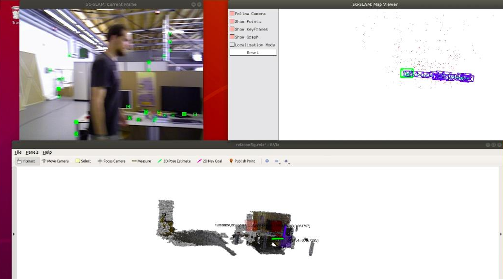
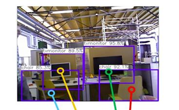
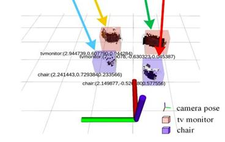

Feature-based visual SLAM assumes the world holds still. It doesn't. When someone walks through the frame, their features get matched across keyframes like any other, and the optimiser dutifully fits a camera trajectory to a person who was never part of the scene geometry. On the TUM `fr3/walking_*` sequences this is not a marginal degradation — ORB-SLAM2's absolute trajectory error goes to roughly half a metre.

This project reimplements **SG-SLAM** ([Cheng, Sun, Zhang & Zhang, *IEEE TIM* vol. 72, 2023](https://ieeexplore.ieee.org/document/10018238)), which addresses this by adding two parallel threads to ORB-SLAM2 — one for object detection, one for semantic mapping — and a feature-rejection stage in the tracking thread that consults both geometry and semantics before deciding what to keep.


*The three threads running together. Left: the live frame — note the green ORB features sit on desks, walls and shelving, not on the person. Bottom: the reconstructed point cloud with detected objects labelled and localised.*

---

## Why not just mask out the people

The obvious approach is to run a detector, draw boxes around every *a priori* dynamic class, and discard whatever falls inside. That fails in both directions, and SG-SLAM's design is a direct response to each failure:

- **Things move that aren't in a box.** A detector trained on 20 classes will miss a swinging door, a rolling cart, a shadow. Masking gives you no protection outside the boxes it drew.
- **Things in boxes aren't always moving.** A parked chair, an empty sofa, a person sitting perfectly still — all get classified dynamic, all get thrown away. In a cluttered indoor scene that can mean discarding the best-textured features you have.

## The rejection criterion

The mechanism that avoids both is worth reading closely, because it is subtler than a mask. Reproduced from the paper's Algorithm 1:

```text
Input:  Previous frame F1, current frame F2
        Feature points P1 (previous), P2 (current)
        Standard empirical threshold e_std
Output: Set S of static feature points in the current frame

 1: P1 = CalcOpticalFlowPyrLK(F2, F1, P2)
 2: Remove matched pairs at image edges or with large appearance variation
 3: F = FindFundamentalMat(P2, P1, 7-point method with RANSAC)
 4: for each matched pair (p1, p2) in (P1, P2) do
 5:     if DynamicObjectsExist and IsInDynamicRegion(p2) then
 6:         if CalcEpiLineDistance(p2, p1, F) * GetDynamicWeightValue(p2) < e_std then
 7:             append p2 to S
 8:         end if
 9:     else
10:         if CalcEpiLineDistance(p2, p1, F) < e_std then
11:             append p2 to S
12:         end if
13:     end if
14: end for
```

There is **one** threshold, `e_std`, and it is compared against a point-to-epipolar-line distance in both branches. The difference is that inside a detected region (line 6) that distance is first **multiplied** by the object class's dynamic weight.

So semantics act as a per-class multiplier on the geometric residual, not as a veto. A high-weight class like a person has its residual inflated, so it gets rejected on much weaker geometric evidence than a low-weight class like a chair. But a genuinely stationary object still passes — its epipolar distance is near zero, and scaling near-zero by three is still near-zero. Meanwhile line 10 runs everywhere the detector saw nothing, so unmodelled motion is still caught geometrically.

Two implementation details that are easy to miss: the optical flow at line 1 runs **backwards**, tracking the current frame's points into the previous frame to reconstruct correspondences, and the fundamental matrix uses the **seven-point** method inside RANSAC rather than the more common normalised eight-point variant.

## Detector

Detection runs an **SSD with a MobileNetV3 backbone under NCNN**, Tencent's mobile CPU inference framework. That choice is what makes the real-time claim plausible without a GPU in the loop — the whole point of SG-SLAM over heavier semantic-SLAM systems is that it targets mobile platforms. The tracking thread computes its geometric quantities, blocks on the detector's 2-D result for that frame, then runs rejection and tracks; only surviving features reach local mapping, loop closing and full bundle adjustment, all of which are unmodified ORB-SLAM2.

<div style="display:grid;grid-template-columns:1fr 1fr;gap:1rem;align-items:start">
<div>


*Detection on a live frame.*

</div>
<div>


*Objects localised in 3-D with class labels.*

</div>
</div>

The semantic mapping thread fuses the 2-D detections with per-keyframe point clouds generated from the depth images and camera poses, then extracts each object's position and extent into a 3-D semantic object database. That database, a global OctoMap and the camera poses are all published over ROS for RViz — which is the real difference from plain ORB-SLAM2, whose output is a sparse cloud with no idea what anything is.

---

## Results

Benchmark figures below are the published results from Cheng et al., reproduced here rather than independently measured. Metric is **ATE RMSE in metres** — these are error *reductions*, not accuracy gains.

### TUM RGB-D

| Sequence | Dynamics | ORB-SLAM2 | SG-SLAM | Reduction |
|---|---|---|---|---|
| `fr3/walking_static` | high | 0.4032 | 0.0079 | **98.03%** |
| `fr3/walking_xyz` | high | 0.6826 | 0.0171 | **97.50%** |
| `fr3/walking_rpy` | high | 0.5396 | 0.0326 | **93.95%** |
| `fr3/walking_halfsphere` | high | 0.4462 | 0.0309 | **93.07%** |
| `fr3/sitting_static` | low | 0.0087 | 0.0060 | **31.03%** |

### Bonn RGB-D Dynamic (9 sequences)

Best and worst of the set: `synchronous2` improves 1.4069 → 0.0164 m (**98.83%**), while `synchronous` — nominally the same scene, different take — only reaches 1.1411 → 0.3262 m (**71.41%**). The `moving_nonobstructing_box` pair land around 71–79%, the `crowd` and `person_tracking` sequences 93–97%.

### Reading the numbers honestly

Two things about this table are worth saying out loud, because they're the parts a results summary usually hides.

**The 31% on `sitting_static` isn't a weak result, it's the control.** That sequence is low-dynamic — a person seated, barely moving. There is almost nothing for dynamic-feature rejection to remove, so the gain collapses to a third of what the walking sequences show. The rotational-drift table is starker still: 7.99% on the same sequence. That's the expected shape of the result, and it's evidence the mechanism is doing what it claims rather than just globally discarding features.

**RMSE improves far more than the median does.** On `walking_static` the ATE RMSE drops 98% while the RPE median improvements sit at 43–53%. The gain is concentrated in *catastrophic* frames — the ones where a person crossing the view wrecks the pose estimate entirely — not in the typical frame. That's the right thing for a SLAM system to fix, since a single badly-corrupted keyframe propagates into the map, but it does mean "98% better" describes the tail, not the average.

---

## Where it breaks

The failure mode falls straight out of Algorithm 1, and the paper is upfront about it: **an object moving along the epipolar line direction is invisible to this test.** Its features produce a point-to-epipolar-line distance of approximately zero despite genuinely moving, so line 10 accepts them as static. The semantic branch doesn't save you either — multiplying a near-zero residual by a dynamic weight still clears the threshold. In practice that means someone walking directly toward or away from the camera is much harder to reject than someone crossing the view.

The other open item is semantic map precision. Object extents come from thresholding a depth-derived point cloud inside a 2-D box, which is coarse — good enough to say "there is a monitor at roughly here", not good enough for manipulation.

## Stack

C++ (ORB-SLAM2 core), Python, Ubuntu 18.04, ROS Melodic, NCNN, OpenCV, OctoMap, RViz. Evaluated on TUM RGB-D and the Bonn RGB-D Dynamic dataset.
